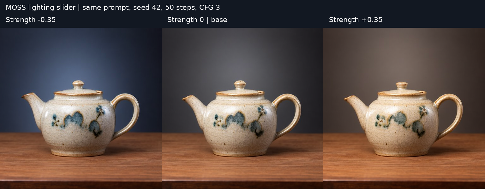
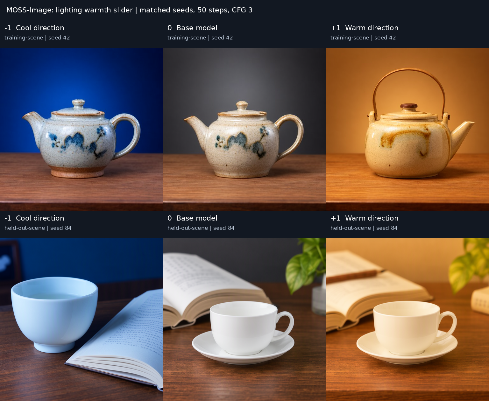

# MOSS-Image Sliders

Signed concept LoRA controls for the pinned OpenMOSS MOSS-Image-SFT model.
Training now executes the installed `particle-sliders-core` conditional GAN with
**ParticleGAN 0.9.1**, public `bispf_optimized`, native velocity fields, and
independent balanced generator/critic sampling. Losses and optimizers live in the
shared package; this derivative contains the MOSS model loader and adapter hooks.

This is an adapter GAN. There is no routed particle bank to regularize. Only
attention LoRA leaves train; transformer weights and Qwen conditioning stay frozen.
The historical lighting images below used the earlier MSE baseline and its old
CFG protocol. They are preserved with their original provenance and do not qualify
the new GAN path. New pretrained CUDA/image validation remains pending.

## Samples

**Start around magnitude 0.35 for this lighting pilot.** Each row keeps its prompt,
seed, 512 × 512 resolution, 50 Euler steps and CFG 3 fixed; only signed adapter
strength changes. The controls run **cool → off → warm**. These are actual model
outputs from the same trained adapter, not color-filtered or blended previews.

### Lighting warmth · gentle

**Cool · −0.35** → **Off · 0** → **Warm · +0.35**



Full resolution: [−0.35](samples/lighting-warmth/teapot/minus-0.35.png) ·
[Off](samples/lighting-warmth/teapot/off.png) ·
[+0.35](samples/lighting-warmth/teapot/plus-0.35.png)

<details><summary>Prompt and seed</summary>

A ceramic teapot on a wooden table, studio photograph.

Seed: `42`. This is the neutral caption from the training triplet.

</details>

### Lighting warmth · full strength and held-out scene

**Cool · −1** → **Off · 0** → **Warm · +1**



Full resolution, teapot: [−1](samples/lighting-warmth/teapot/minus-1.png) ·
[Off](samples/lighting-warmth/teapot/off.png) ·
[+1](samples/lighting-warmth/teapot/plus-1.png)

Full resolution, held-out cup/book: [−1](samples/lighting-warmth/held-out-cup-book/minus-1.png) ·
[Off](samples/lighting-warmth/held-out-cup-book/off.png) ·
[+1](samples/lighting-warmth/held-out-cup-book/plus-1.png)

<details><summary>Prompts and seeds</summary>

Top row: A ceramic teapot on a wooden table, studio photograph.

Seed: `42`.

Bottom row: A white porcelain cup beside an open book on a wooden desk, studio photograph.

Seed: `84`. This scene was not used in training.

</details>

The cool-to-warm direction is visible in both scenes. **Full strength also changes
geometry and composition:** the +1 teapot changes its handle/spout, and the −1
held-out cup loses its handle. This is not clean relighting. The moderate ramp retains
the teapot's shape much better, with small texture changes. These are development
examples from one training triplet, not a final-test benchmark or a general quality claim.
Zero strength matches the separately rendered [adapter-free baseline](samples/lighting-warmth/teapot/adapter-free.png)
pixel for pixel on the teapot scene.

<details><summary>Training, inference and provenance</summary>

Base: [MOSS-Image-SFT](https://huggingface.co/OpenMOSS-Team/MOSS-Image-SFT), pinned to
`fc5de0d56fc910cbca6f6625a70f5f582b26deb1`. Training and rendering code:
[`a6f5cd0`](https://github.com/HyperGAN/moss-image-sliders/commit/a6f5cd06aa561d0edd495656509a712c6c4b8ead).
Generated 2026-10-17 on one RTX A6000.

Training: 60 updates; rank/alpha 4; LR 0.0003; direction strength 1; seed 42;
512px; four-step frozen neutral rollouts; token cap 256; frozen DiT base and text
encoder. Neutral caption: `A ceramic teapot on a wooden table, studio photograph.`
Positive caption adds `warm golden lighting.`; negative adds `cool blue lighting.`
Exact strings and file SHA256 values are in the [provenance manifest](samples/lighting-warmth/provenance.json).

The executed objective is signed LoRA contrastive velocity distillation. At the same
latent and timestep, frozen teachers give `delta = v(positive) - v(negative)` and
`base = v(neutral)`. The neutral-caption student at signs +1 and −1 minimizes the mean
of the two velocity MSEs against `base + delta` and `base - delta` respectively.
There is **no discriminator, adversarial loss, or ParticleGAN/BISPF call** in this
pilot's executed training path. Scale zero bypasses the adapter exactly.

Inference: fresh matched-seed CPU generator for each strength; 50 steps; CFG 3;
scheduler shift 5; negative prompt empty; negative branch skips layer 22. PNGs are
published unchanged, with contact-sheet labels added outside the generated images.
Only examples and their documentation/provenance are published here; the trained
adapter and private result bundle remain private.

</details>

## Install and CPU qualification

Python 3.10–3.12. The shared package dependency is pinned to the proposed source
commit `4be0b5b29d2e2c741431f468d71ba8a7c884b724` (pending Ada approval) in `pyproject.toml`; ParticleGAN stays exactly 0.9.1. Install the matching
shared package before importing training or inference. See
[the integration audit](docs/shared-pg09-audit.md) for the exact integration pin
and CPU receipt. Do not retarget an environment used by a running campaign.

```bash
uv sync --frozen --extra dev --extra ui
uv run --frozen moss-sliders smoke --receipt outputs/gan-smoke.json
uv run --frozen pytest -q
```

The separately hashed `requirements-cpu.lock` contains CPU runtime dependencies.
After synchronizing it, install the exact shared source and this project without
resolving a different runtime:

```bash
uv pip install --no-deps 'particle-sliders-core[serialization] @ git+https://github.com/HyperGAN/particle-sliders.git@4be0b5b29d2e2c741431f468d71ba8a7c884b724#subdirectory=packages/particle-sliders-core'
uv pip install --no-deps -e .
```

 Never synchronize the CUDA lock into an existing
CPU environment. CPU tests use a real tiny random MOSS architecture, no pretrained
weights, VAE, network, or GPU. The smoke executes the shared GAN, portable adapter
reload and exact full-game disk resume; it makes no image-quality claim.

## Train a concept

The example JSON recipes explicitly name `pg09_gan_only`, ParticleGAN `0.9.1`,
`bispf_optimized`, and batch size. Recipes from the old MSE trainer fail validation.
Training and inference preflight the full native chat template before any
encoder forward. An over-budget prompt fails instead of being silently truncated.

```bash
moss-sliders train --config examples/warm-light.json \
  --output checkpoints/new-gan-run --device cuda:0
```

Model loading is local-only unless `--download` is explicitly supplied. Real runs
require coordinator GPU admission. For each frozen neutral rollout state the two
signed teachers are `base +/- strength * (positive - negative)`. The student uses
the neutral caption. Critic conditions contain mask-weighted normalized neutral
Qwen features plus native time, sign and strength. Frozen edit RMS from training
states sets the response coordinate scale; no reconstruction/MSE loss is trained.
The shared recipe owns both optimizers and its public adversarial/penalty terms.

The output is a new directory containing `run.json`, metrics, immutable full-game
checkpoints and an `adapter/` portable v2 export. For an interrupted run, use a new
output directory and the original full checkpoint and unchanged recipe:

```bash
moss-sliders train --config examples/warm-light.json \
  --resume checkpoints/new-gan-run/checkpoints/step-000010 \
  --output checkpoints/resumed-gan-run --device cuda:0
```

Resume restores actual completed steps, both optimizers, critic, adapter, model
RNG, independent noise/row streams, shuffled orders, cursors and exposure counts.
The total budget remains the original recipe's budget. Model, prompt, conditioning,
source, runtime, recipe or objective changes fail closed. Adapter-only exports and
legacy MSE optimizer packets cannot resume a GAN run. Existing source-bound native
campaign checkpoints must continue under their original admitted runtime; package
relocation is a new lineage and requires a new cohort or reviewed migration.

## Frozen campaign caches

`moss-sliders train-campaign --cache /path/to/cache --output /new/run` executes the
same shared game using `MossCampaignRows` and `build_campaign_run`. It reads verified
cached targets lazily and never changes the original cache. Conditions, paired
signs, native fields, train-only scale calibration and balanced coverage are shared
with the upstream campaign implementation. The legacy `tools/train_campaign.py`
now forwards explicitly to this command and requires a new `--output`.

`tools/monitor_campaign.py` and the autonomous CUDA smoke are retired and start
no processes. GPU admission and native qualification belong to the coordinator.
No user command dispatches the old hard-coded active campaign checkout.

## Render a matched-seed ramp

```bash
moss-sliders infer --adapter checkpoints/new-gan-run/adapter \
  --prompt 'A ceramic teapot on a wooden table, studio photograph.' \
  --scales -1 -0.5 0 0.5 1 --seed 42 --steps 50 --guidance 3 \
  --width 1024 --height 1024 --output outputs/gan-ramp --offload
moss-sliders ui --adapter checkpoints/new-gan-run/adapter --offload
```

Inference and UI execute the shared MOSS response backend. CFG adapts only the
conditional branch, keeps the empty-prompt branch frozen, and disables negative
layer skipping. Each strength gets fresh identical-seed FP32 noise and a fresh
copy of the native scheduler. The shared decoder retains native VAE normalization
and unpacking. At zero, latents match an unattached native baseline under this
same no-skip protocol. Historical v1 adapters remain readable; their appearance
can differ under the corrected CFG protocol. Raw source-bound campaign exports
require validation with their original `MossCampaignRun.load_adapter` and explicit
conversion to portable v2, rather than guessing their parameter mapping.

The UI serializes requests, binds to 127.0.0.1, and creates no public share link.
Native CUDA/BF16, real VAE output, offload hooks, peak memory and visual quality
remain separate coordinator-admitted gates. No trained weights are published.
